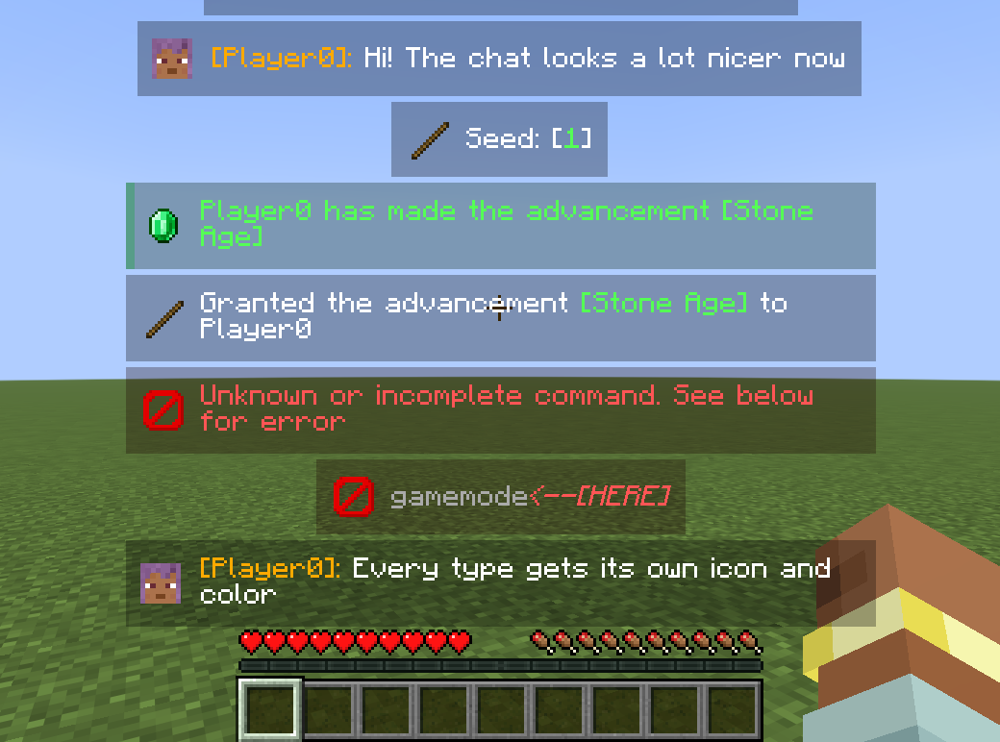
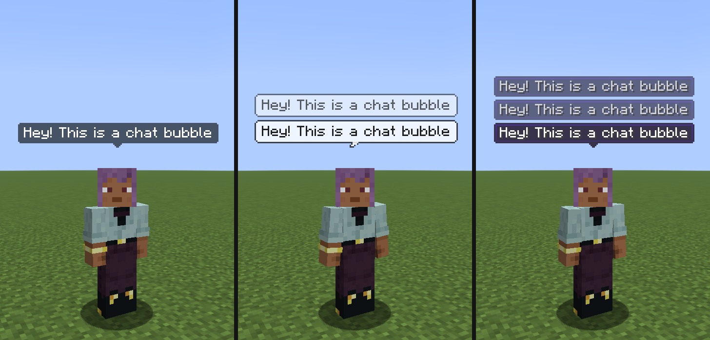
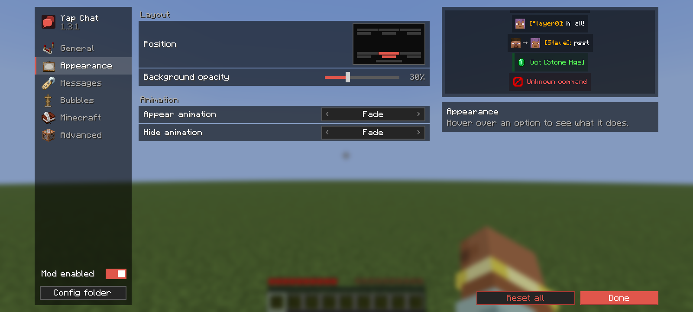
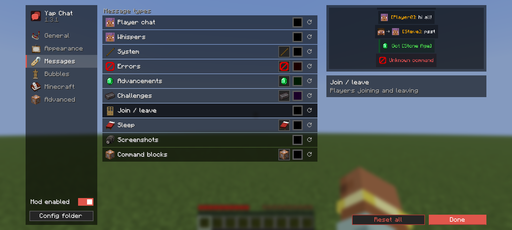
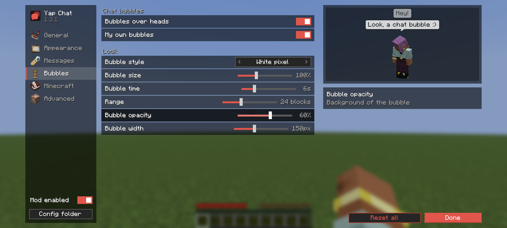
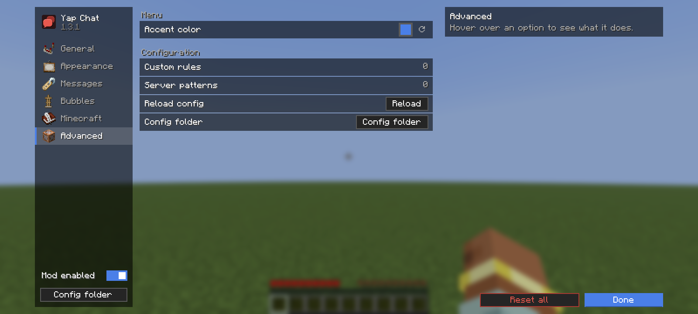

# Yap Chat

A chat replacement for Minecraft (Fabric). Every message gets its own box with an icon or the player's head, chat bubbles pop up above players' heads, and everything is set up in one settings screen.

**[Download on Modrinth](https://modrinth.com/mod/yap-chat)** · [Releases](https://github.com/Dev14dbq/Yap-Chat/releases) · [Report a bug](https://github.com/Dev14dbq/Yap-Chat/issues)



## Features

- **Message boxes.** Player chat shows the author's head; system messages, errors, advancements, challenges, join/leave, sleep, screenshots and command blocks each get their own icon and background color.
- **Whispers** show both heads with an arrow: who wrote to whom.
- **Chat bubbles** above the player who wrote in public chat, in four styles, with size, time, range, opacity and width settings.
- **Anti-spam** merges repeated messages into one with a counter (`x3`).
- **Animations** for messages coming in and leaving: fade, slide in any direction, bounce or none.
- **Six positions** on screen: top or bottom, left, center or right.
- **Works on any server and in any language.** Message types are recognised from what the game reports (chat type, translation keys), plus built-in patterns for EssentialsX/CMI, Hypixel-style and common `[Rank] Name » text` formats.
- **12 languages:** English, Русский, Deutsch, Español, Português (Brasil and Portugal), Italiano, Polski, Türkçe, 한국어, 日本語, العربية.

## Chat bubbles



Dark, white pixel and tooltip styles (there is also a plain name-tag style). Resource packs can restyle every one of them, see [below](#restyling-bubbles-with-a-resource-pack).

## Settings

Open them from **Options → Chat Settings** (Yap Chat replaces the vanilla screen, the vanilla chat options are in the Minecraft tab) or from **Mod Menu**. Every change applies right away; the right column explains the option under the mouse and shows a live preview.

**Appearance:** position, background opacity, appear and hide animations with a looping preview.



**Messages:** icon and background color for every message type.



**Bubbles:** style, size, time, range, opacity and width, with a preview on your own character.



**Advanced:** accent color of the menu (not everyone likes red), custom rules and server patterns, config folder.



Also: **General** (styling, anti-spam, show time, visible messages, history size) and **Minecraft** (all vanilla chat options).

## Server message formats

If your server uses its own private message or chat format, add a pattern to `config/yap-chat.json`:

```json
"serverPatterns": [
  { "id": "my-server-pm", "regex": "^✉ (?<from>\\w+) » (?<to>\\w+): (?<body>.*)$", "type": "WHISPER" }
]
```

Named groups: `from` / `to` (private messages; `me`, `я` or your nick mean you), `name` (chat author, must be online), `body` (the message).

## Restyling bubbles with a resource pack

Every bubble style is drawn from resources, so a resource pack can replace any of them. `<style>` is `dark`, `white`, `tooltip` or `nametag`.

| File | What it is |
| --- | --- |
| `assets/yap-chat/textures/gui/sprites/bubble/<style>.png` | Bubble body. Stretched as a nine-slice; set the border in `<style>.png.mcmeta` (same format as vanilla GUI sprites). |
| `assets/yap-chat/textures/gui/sprites/bubble/<style>_tail.png` | Tail under the body. |
| `assets/yap-chat/bubbles/<style>.json` | Text and layout settings, see below. |

```json
{
  "text_color": "#202020",
  "text_shadow": false,
  "padding_x": 5,
  "padding_y": 4,
  "min_opacity": 0.5,
  "tail": true,
  "tail_width": 6,
  "tail_height": 4,
  "tail_anchor": 4,
  "tail_overlap": 1
}
```

- `min_opacity`: the bubble opacity slider maps 0–100% onto `min_opacity`–100%.
- `tail_anchor`: x pixel of the tail that sits under the bubble's center (the tip).
- `tail_overlap`: how many tail rows are drawn over the bottom of the body (to cut through its outline).

Changes apply on `F3+T`.

## Versions

| Minecraft | Branch |
| --- | --- |
| 26.3 | [`main`](https://github.com/Dev14dbq/Yap-Chat/tree/main) / [`26.3`](https://github.com/Dev14dbq/Yap-Chat/tree/26.3) |
| 26.2 | [`26.2`](https://github.com/Dev14dbq/Yap-Chat/tree/26.2) |
| 26.1.2 | [`26.1.2`](https://github.com/Dev14dbq/Yap-Chat/tree/26.1.2) |
| 26.1.1 | [`26.1.1`](https://github.com/Dev14dbq/Yap-Chat/tree/26.1.1) |
| 26.1 | [`26.1`](https://github.com/Dev14dbq/Yap-Chat/tree/26.1) |

Requires [Fabric Loader](https://fabricmc.net/) and [Fabric API](https://modrinth.com/mod/fabric-api). [Mod Menu](https://modrinth.com/mod/modmenu) is optional. Client-side only.

Yap Chat used to be called KKS Chat; an old `config/kks-chat.json` is picked up automatically.

## Building

```bash
./gradlew build
```

The jar is in `build/libs`. `./gradlew runClientGameTest` starts the game and checks how real messages are classified.

Every push and pull request is built by GitHub Actions ([Build](.github/workflows/build.yml)), and the in-game tests run on the branches that have them.

## Releasing

1. On every version branch that gets the release, set `mod_version` in `gradle.properties` and push.
2. Publish a GitHub release with the tag `v<mod_version>` (for example `v1.3.4`) and the changelog as its text.

The [Release](.github/workflows/release.yml) workflow then builds each branch whose `mod_version` matches the tag, attaches the jars to the release and uploads them to Modrinth (needs the `MODRINTH_TOKEN` secret). Branches on another version are skipped. To run it again for an existing release: Actions → Release → Run workflow.

## Support

Questions and ideas: Discord **ddev14**, or [open an issue](https://github.com/Dev14dbq/Yap-Chat/issues).

## License

[GNU General Public License v3.0](LICENSE)
